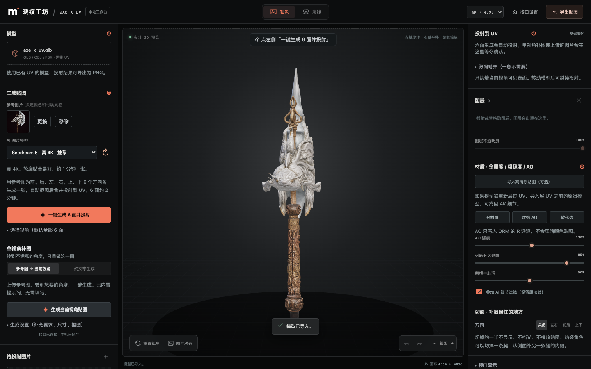
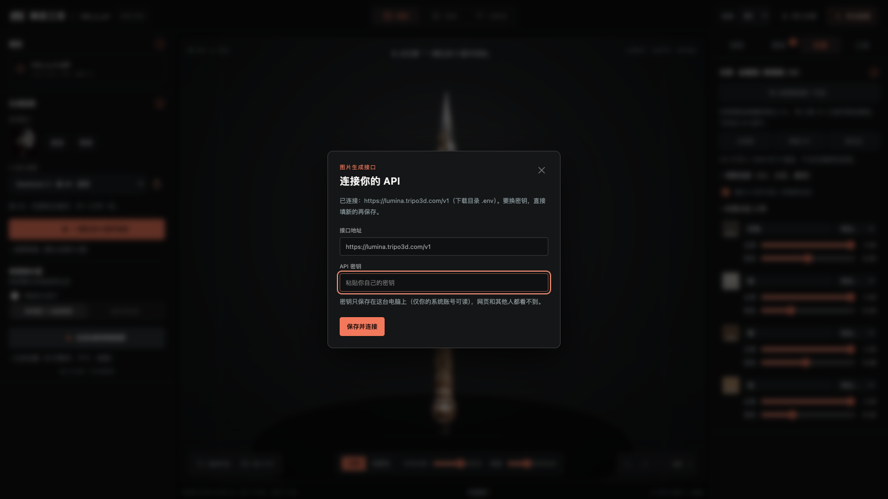
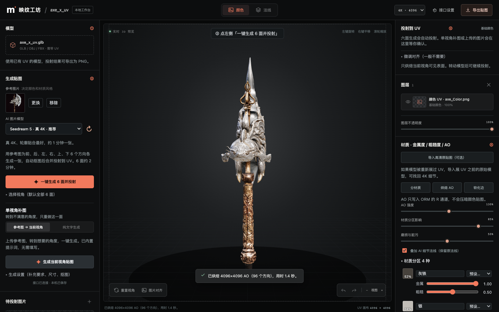
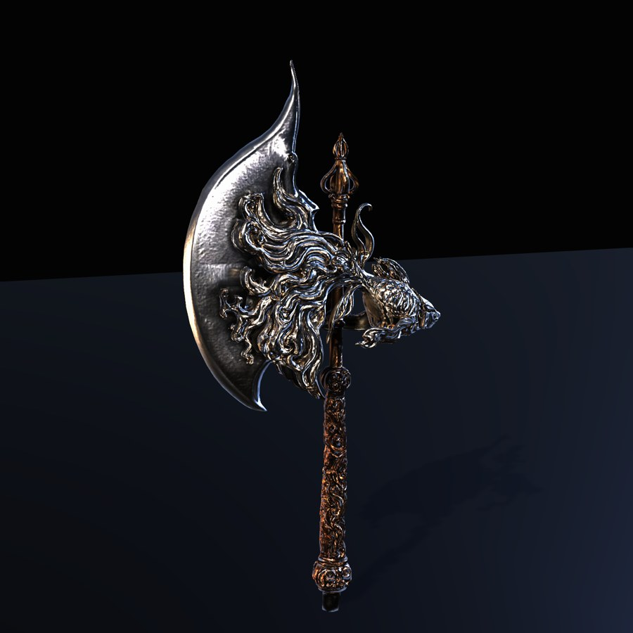

# 映纹工坊 · 3D 贴图工作台

给带 UV 的 3D 模型一键生成 4K 贴图的本地工具。导入模型、放一张参考图，点一下就会从前、后、左、右、上、下 6 个方向用 AI 生成画面，自动抠图、去光照，再烘焙到模型 UV 上。之后可以分材质、烘焙 AO，导出 UE5 / Unity 能直接用的 BaseColor、Normal、ORM 贴图。

界面全中文，不用写提示词，也不用写代码。



## 下载安装（给同事用）

到右侧 **Releases** 下载对应的安装包，解压即用，不需要安装 Node 或任何其他软件。

| 电脑 | 下载 | 打开方式 |
|---|---|---|
| Mac（M1/M2/M3/M4 芯片） | `YingwenWorkbench-mac-arm64.zip` | 解压后**右键**「YingwenWorkbench-mac-arm64」→「打开」→ 再点「打开」 |
| Mac（Intel 芯片） | `YingwenWorkbench-mac-x64.zip` | 同上 |
| Windows 10 / 11 | `YingwenWorkbench-win-x64.zip` | 解压后双击 `Start-Yingwen-Workbench.bat` |

> 不知道 Mac 是什么芯片：左上角苹果菜单 →「关于本机」，芯片写 Apple M 开头的选 arm64，写 Intel 的选 x64。

打开后浏览器会自动弹出工作台页面。

- **Mac 第一次打开**：要用「右键 → 打开」。安装包没有苹果开发者签名，直接双击会提示「无法验证开发者」，右键打开一次以后就能正常双击了。
- **Windows**：会弹出一个黑色窗口，那是软件本体，用的时候不要关。如果出现「Windows 已保护你的电脑」，点「更多信息」→「仍要运行」。
- **退出**：关掉浏览器标签页，软件约 3 分钟后自动退出。Windows 也可以直接关掉黑色窗口。

### 第一次使用：填 API 密钥

第一次打开会弹出「连接你的 API」。粘贴你自己的密钥，点「保存并连接」即可。



- 密钥只保存在你这台电脑上，只有你的系统账号能读，网页和其他人都看不到。
- 之后再打开会自动连接，不用重新填。
- 换密钥：右上角「接口设置」里填新的再保存；「清除已保存的密钥」可删除。

## 怎么用

左侧按 1、2 两步生成，右侧分成 **投射 / 图层 / 材质 / 工具** 四个标签，操作时会自动切到对应的标签。视口上方的提示条会告诉你下一步做什么。可以直接把模型或参考图拖进视口。

1. **① 模型**：导入带 UV 的 GLB / OBJ / FBX（推荐 GLB）。多部件模型会列出部件，可以先隐藏挡在前面的部件。
2. **② 生成贴图**：上传参考图，点「**一键生成 6 面并投射**」。6 个方向同时生成（每张约 1 分钟，总共约 2 分钟），完成后自动贴到模型上。
   - 生成结果显示成一排 6 张小图。鼠标移上去可以「用 / ↻ 重做 / ◎ 查看」这一面。
   - 某个角度没贴好：转到那个角度，用「单视角补图」只重做这一面。
   - **局部放大细节**：龙头这类细节多的地方，勾选「局部放大细节」，先把那一块放大到占满画面，再点生成。投射时边缘会自动渐隐，和周围融合。
   - 顶部切到「**法线**」或「**自发光**」，再点一次「一键生成 6 面」，就是对应的贴图。
3. **③ 投射**（右侧「投射」标签）：单视角补图或上传的图片会停在这里，确认对齐后点「投射并烘焙到 UV」。上传的图如果本身就是 UV 贴图，会自动识别，改成「直接替换」。
4. **④ 材质**（右侧「材质」标签）：
   - 「分材质」：按颜色自动分成几种材质（如银、铜、金、灰铁）。每种可以选预设或调金属、粗糙；鼠标悬停时，模型上会高亮对应区域。
   - 「烘焙 AO」：4K 环境光遮蔽，只写进 ORM，不会压暗颜色贴图。
   - 「软化边」：合并接缝硬边（已是软边时不改动）。
   - 「导入高清原贴图（可选）」：模型重新展过 UV、贴图被降到 2K 时（例如 Tripo 智能展 UV），导入展 UV 之前的原始模型，可以找回 4K 颜色、法线和金属粗糙度。
5. **工具**（右侧「工具」标签）：切面（被挡住、贴不到的地方，切掉一半模型再生成；人形模型会出现「一键补腿内侧」）和视口显示设置。
6. **导出**：点右上角「导出贴图」。

### 只投射一部分（画笔）

生成或上传一张图后，在右侧「投射」标签勾选「只投射一部分」，然后在视口里用画笔涂上要投射的地方，没涂的地方（红色）保持原样。可以切换画笔 / 橡皮，调大小和软硬，也有全选、清空、反选、撤销一笔。快捷键：`[` `]` 调画笔大小，`X` 切换画笔 / 橡皮。

### 自发光贴图

顶部切到「自发光」后点「一键生成 6 面」。AI 只画参考图里会发光的地方（眼睛、宝石、符文、熔岩等），其他地方都是黑色。如果某一面被 AI 画成了普通颜色，会自动跳过，可以点 ↻ 重试。右侧「投射」标签里可以调发光强度。

### 视口灯光

视口底部可以切换「光照 / 纯颜色」。「纯颜色」会去掉所有灯光，只看颜色贴图本身；「灯光方向」可以转动主光，侧光下能看清法线细节。

### 快捷键

| 键 | 作用 |
|---|---|
| G | 一键生成 6 面 |
| P | 投射到 UV |
| 1 / 2 / 3 | 切换 颜色 / 法线 / 自发光 |
| U | 光照 / 纯颜色 |
| F | 重置视角 |
| E | 导出 |
| ⌘Z | 撤销 |
| ? | 显示快捷键 |



### 导出给引擎

| 文件 | 用于 | 说明 |
|---|---|---|
| BaseColor PNG | 全部 | sRGB |
| Normal PNG | 全部 | OpenGL 格式。UE5 导入时勾选 **Flip Green Channel** |
| ORM PNG | UE5 | R=AO，G=粗糙度，B=金属度；导入时关闭 sRGB |
| Unity URP 贴图 | Unity | MetallicSmoothness 拖到 Metallic Map（Source 选 Metallic Alpha）；AO 拖到 Occlusion Map |
| Emissive PNG | 全部 | 黑色 = 不发光。UE5 接 Emissive Color；Unity 勾选 Emission 后放进 Emission Map |
| GLB 模型 | 全部 | 带上面所有贴图 |

默认导出 4096×4096，可在右上角切换到 8K（8K 是更精细的烘焙，不会比 4K 原图多出细节）。

下面是导出的贴图在 Unity URP 里的效果：



## 注意事项

- 模型需要先有 UV。重叠或镜像的 UV 无法分开上色（两边会一样）。
- AI 生成的图偶尔会带少量光影或细节偏差，生成后转一圈检查一遍，再决定要不要补图。
- 刷新页面会丢失未导出的工作，记得先导出 GLB。
- 生成会消耗你自己 API 账号的额度，Seedream 5 一张约 0.03 美元。

## 实测的 AI 模型

2026-11 在 Lumina 接口上实测（同视角、同参考图）：

| 模型 | 实际尺寸 | 轮廓贴合 | 单张耗时 |
|---|---|---|---|
| Seedream 5（默认，推荐） | 真 4096 | 好 | 45–67 秒 |
| Seedream 5 Lite | 真 4096 | 好 | 约 45 秒 |
| Gemini 3 Pro | 1024 | 较好 | 约 30 秒 |
| GPT Image 2.5 | 最高 2048 | 会改轮廓 | 25–41 秒 |

没有模型能原生生成 8K。

---

## 开发者

```sh
npm install
npm run dev        # http://127.0.0.1:5173 ，接口服务在 8787
npm test           # 接口和提示词测试
npm run build
node scripts/package.mjs   # 打包 Mac arm64 / Mac x64 / Windows x64 安装包到 packages/
```

开发时也可以把 `LUMINA_BASE_URL` 和 `LUMINA_API_KEY` 写进 `~/Downloads/.env`（或用 `WORKBENCH_ENV_FILE` 指定）。在软件里保存的密钥优先，位置：

- Mac：`~/Library/Application Support/YingwenWorkbench/api.env`
- Windows：`%APPDATA%\YingwenWorkbench\api.env`

浏览器内的检查页：`/tests/texture-check.html`（投射、遮挡、法线转换），`/tests/pbr-check.html`（抠图、去光照、贴图转烘焙、AO）。
